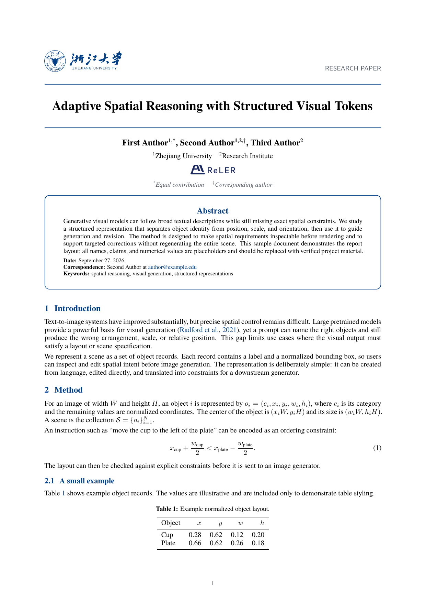
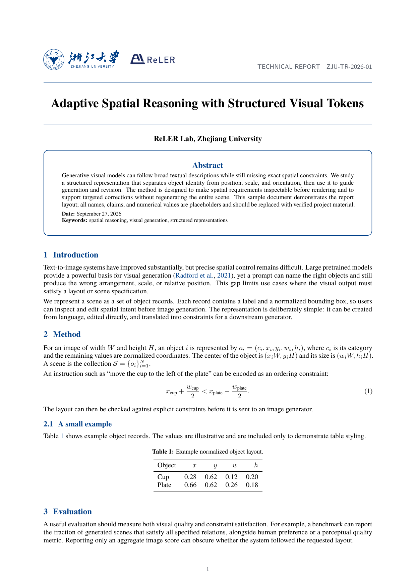

# ZJU Report Templates

面向浙江大学学习与科研场景的 Typora 主题和 LaTeX 报告模板合集。包含本科课程/实验报告样例，以及独立的英文技术报告与论文模板。项目由个人维护，非浙江大学官方模板。

## 技术报告与论文预览

| 论文模式 | 技术报告模式 |
| --- | --- |
|  |  |

## 模板与说明

| 内容 | 目录说明 |
| --- | --- |
| ZJU 技术报告 / 论文 LaTeX 模板 | [模板介绍、模式切换与编译说明](zju-tech-report/README.md) |
| LaTeX 小组报告样例 | [模板说明](latex/README.md) · [源文件](latex/group-report.tex) |
| Typora GitHub 风格主题 | [主题说明与安装](typora-markdown/mygithub/README.md) · [CSS 文件](typora-markdown/mygithub/mygithub.css) |
| Typora LaTeX 风格主题 | [主题说明与报告封面模板](typora-markdown/mylatex/README.md) · [CSS 文件](typora-markdown/mylatex/mylatex.css) |

各目录 README 介绍对应模板的使用方法、字体和注意事项。不同模板适用场景与编译方式不同，请按目录说明配置。

欢迎通过 Issue 和 Pull Request 提交问题、建议与改进。
