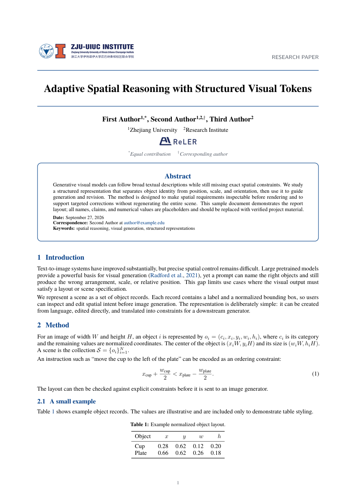
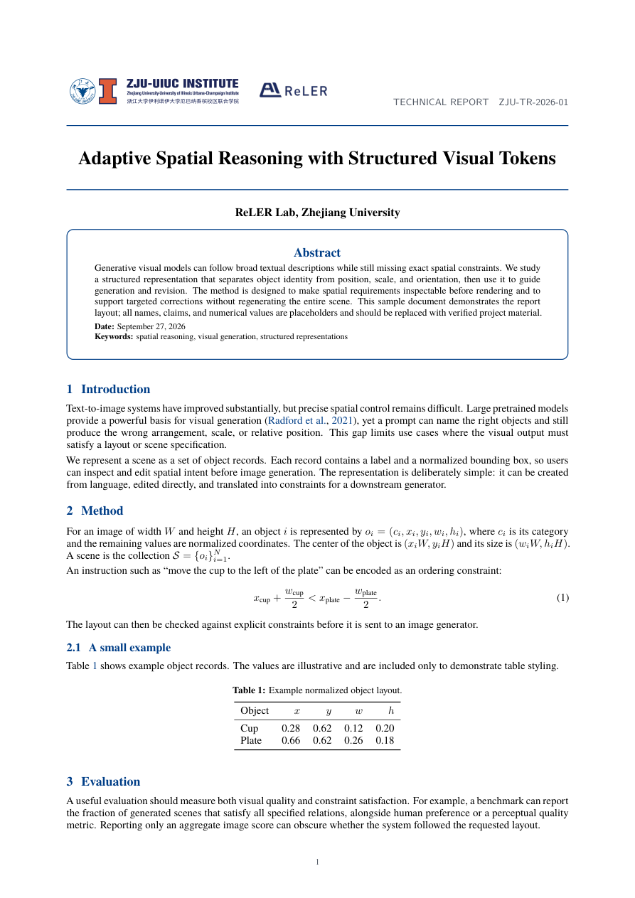

# ZJU Report Templates

面向浙江大学学习与科研场景的 Typora 主题和 LaTeX 报告模板合集。包含本科课程/实验报告样例，以及独立的英文技术报告与论文模板。项目由个人维护，非浙江大学官方模板。

## 技术报告与论文预览

| 论文模式 | 技术报告模式 |
| --- | --- |
|  |  |

## 模板与说明

| 内容 | 目录说明 |
| --- | --- |
| ZJU 技术报告 / 论文 LaTeX 模板 | [模板介绍、模式切换与编译说明](zju-tech-report/README.md) |
| LaTeX 小组报告样例 | [模板说明](latex/README.md) · [源文件](latex/group-report.tex) |
| Typora GitHub 风格主题 | [主题说明与安装](typora-markdown/mygithub/README.md) · [CSS 文件](typora-markdown/mygithub/mygithub.css) |
| Typora LaTeX 风格主题 | [主题说明与报告封面模板](typora-markdown/mylatex/README.md) · [CSS 文件](typora-markdown/mylatex/mylatex.css) |

各目录 README 介绍对应模板的使用方法、字体和注意事项。不同模板适用场景与编译方式不同，请按目录说明配置。

欢迎通过 Issue 和 Pull Request 提交问题、建议与改进。

## 人工智能安全：ACE 论文展示与阅读报告

当前作业分支为 `assignment-ai-security`，从 `main` 的 `cc1fa9c` 创建。
本分支独立维护本次作业，没有合并高级人工智能 MP2 或其他课程的作业内容。

课程课件名称为 **Trustworthy Artificial Intelligence**。这是个人作业，署名为
**蒋佳豪 / Jiahao Jiang / 22671064**。选题为课程清单中的
**ACE: A Security Architecture for LLM-Integrated App Systems（NDSS 2026）**。

| 文件 | 用途 |
| --- | --- |
| [submission/presentation.pptx](submission/presentation.pptx) | 中文展示，学院模板，9 页正式展示、2 页隐藏备份页 |
| [submission/report.pdf](submission/report.pdf) | 英文阅读报告，2 页，含参考文献 |
| [review/presentation-preview.pdf](review/presentation-preview.pdf) | 11 页静态预览，包含隐藏备份页 |
| [review/speaker-notes-zh.txt](review/speaker-notes-zh.txt) | 中文逐页讲稿、时间分配和引用链接；同样嵌入 PPT 备注 |
| [report/report.tex](report/report.tex) | 报告正文；配套样式改编自仓库技术报告模板 |
| [presentation/build_content.mjs](presentation/build_content.mjs) | 可编辑 PPT 内容的生成源文件 |
| [sources/source-manifest.json](sources/source-manifest.json) | 原始出处、精确页码、数值口径和图像来源 |

课件规定展示共 6 分钟。正式讲稿计划为 **340 秒（5 分 40 秒）**，预留 20 秒用于
切页及口头停顿；实际用时需通过个人彩排校准。第 10、11 页在放映时默认隐藏，问答时可以跳转。
报告和 PPT 的数据均为论文原文结果，拟议的消融实验明确标为后续建议，没有声称完成个人复现。

### 课程要求与取舍

要求来源为同级目录的 `Lecture1.pdf` 第 8–10 页：每位学生展示一篇论文，可以用中文或英文，
时长 6 分钟；每位学生提交英文阅读报告，使用模板，最多 2 页；两项可以选同一篇论文。
报告使用本仓库模板的求是蓝、衬线字体、页边距、标题线与摘要框，替换了示例作者和实验室信息。
PPT 使用同级给定的 `ZJUI学院PPT模板.pptx`，保留学院封面、正文版式及结束页。

课件所列展示提交时间为 2026 年 12 月 14 日或 21 日 12:00，具体以个人场次为准；
报告截止时间为 2026 年 12 月 28 日 12:00。课件没有给出额外的报告评分细则，正文按
研究问题、机制、证据、批判分析和后续验证组织。

### 构建

当前机器可直接运行：

```powershell
python tools/build.py
```

也可只重建报告：

```powershell
python tools/build_report.py
```

依赖：XeLaTeX、BibTeX、latexmk、Windows Microsoft PowerPoint，Python 依赖见
`requirements.txt`；PPT 作者工具使用 Codex 自带的 `@oai/artifact-tool`，不从公共 npm 安装替代包。
`tools/build.py` 自动发现当前 Codex 打包的 Node 和演示文稿技能目录，也接受
`RUNTIME_NODE_MODULES`、`PRESENTATIONS_SKILL_DIR` 环境变量。

`.build/`、逐页图片和下载的原文为本地构建资料，不纳入版本控制。
PPTX 内的两张表与柱状图保持原生可编辑，柱状图带嵌入数据工作簿。
图 3 取自论文原图，只有裁剪，没有改写标签或数值。

### 工具与来源说明

本作业使用 Codex 协助整理、起草、生成与检查文件。公开论文的出处及原文数字已由代理逐项核对；
来源清单没有把代理检查标记为学生本人已经完成的人工复核。构建和排版检查不代表论文实验复现。

科学写作辅助流程参考：Timothy Kassis, Vinayak Agarwal, Yuhuan He, Darshil Patel,
and Aubrey M. Brueckner. *Scientific Agent Skills: A Library of Procedural Knowledge for Research Agents*.
2026. [doi:10.48550/arXiv.2609.00065](https://doi.org/10.48550/arXiv.2609.00065)。
该引用记录工具流程来源，不作为 ACE 的科学证据，也不占课程报告的参考文献篇幅。
